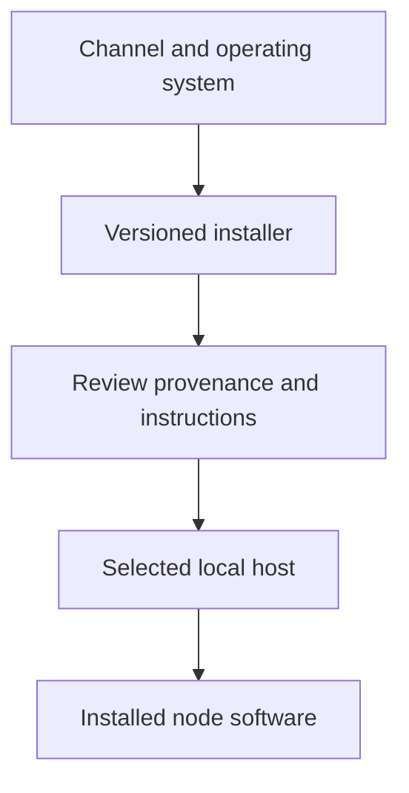

# Component architecture

Conceptual source-oriented view, not a verified deployment diagram. Consult the README code map and configuration catalogue for concrete entrypoints. Provider connections depend on the selected feature and environment.
